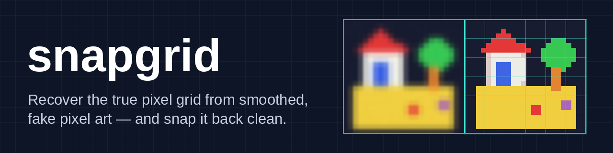

[](LICENSE)
[](#development)
[](https://github.com/RakTikoo/snapgrid/releases)

# snapgrid

Recover the true pixel grid from damaged "fake pixel art" — images that were upscaled with smoothing, AI-generated, or blur/JPEG-damaged — and snap them back to clean, real pixel art, with **one shared grid and one shared palette for a whole sprite sheet or animation**.

## Install

```bash
pip install git+https://github.com/RakTikoo/snapgrid
```

Requires Python ≥ 3.10; dependencies are Pillow and NumPy. CPU only, classical algorithms only — no ML, nothing leaves your machine.

## Usage

Snap a single image:

```bash
snapgrid fix damaged.png --out fixed.png
```

Snap a whole sheet (frames laid out in a grid) or a folder of animation frames — the grid and palette are estimated **jointly across all frames**, so frames can't flicker or drift onto different grids:

```bash
snapgrid sheet sheet.png --rows 2 --cols 4 --out fixed_frames/
snapgrid sheet frames_folder/ --out fixed_frames/
```

Cap the palette if you need to (`--max-colors`, default 256). Every run writes the recovered image(s) plus the shared palette as `.palette.gpl` (GIMP palette) and `.palette.json` sidecars.

Exit codes: `0` success, `2` bad input (clean one-line error), `3` **abstained** — no clean grid found, nothing written. Abstaining is a feature: a wrong grid is worse than no answer.

## Demo


A 24×24 sprite, upscaled 4.3× with bilinear smoothing, blurred, noised, and re-saved as PNG — then recovered. Actual output:

```
$ snapgrid fix house_damaged.png --out house_fixed.png
input: house_damaged.png (103x103)
recovered grid: 24x24 (cell ~4.29x4.29px, offset 0,0)
confidence: 0.93 (resynthesis fit error 3.33/255)
palette: 9 colors -> house_fixed.palette.gpl / house_fixed.palette.json
wrote: house_fixed.png
```

And on something that is not pixel art at all:

```
$ snapgrid fix gradient.png --out gradient_fixed.png
abstained: no clean pixel grid found (the image has almost no hard edges — it looks like a smooth gradient or photo, not damaged pixel art) — leaving the image unchanged
(exit code 3, nothing written)
```

Rebuild the demo with `python examples/make_demo.py`. The demo uses gentler damage than the test suite below (bilinear only, blur 0.5, noise σ 2.5); the suite is deliberately harsher.

## How it works

The detector was redesigned after an independent review found the
original profile-gated detector recovered only ~60% of grids on a gentle
single-damage suite (see `REVIEW.md`). The current method:

1. **Ungated nomination.** Every cell-count pair whose x/y pitches agree is
   a candidate — damaged pixel art has square cells (one upscale factor
   applied to both axes), and *no* profile-fit gate is allowed to eliminate
   the true count before ranking, which was the old detector's main failure
   mode. Phase-offset variants (cropped sprites) are tried for finalists.
2. **Description-length arbitration with phase evidence.** Each candidate
   is scored by how well the *whole image* is explained as snapped cells
   re-damaged by a forward model (crisp = identity for nearest damage,
   smooth = triangle blur for bilinear/bicubic): residual bits from the
   forward-model error, plus a per-cell colour cost, **minus the phase
   evidence** — how much worse the explanation gets when every cut is
   shifted by half a cell. A true grid is uniquely sensitive to that shift;
   finer, coarser, and off-by-one grids are not. Finalists are re-scored
   with exact median sampling plus a palette term (a true grid's snapped
   cells need the fewest distinct colour groups).
3. **Verification and abstention.** The winner must show phase evidence on
   *each axis separately*, must beat every different grid by a clear
   margin (near-ties abstain), and must not have a high forward-model
   error. Because the sweep only admits square-pitch grids, the winner's
   pitch is then verified against *each axis's own evidence*: the axis's
   breakpoint lattice (from its profile, and from per-line breakpoint
   evidence pooled over the image) must have the winner's pitch as its
   period, no coarser count on that axis may beat the winner's full
   score by a clear margin, the *doubled* count on that axis must not
   explain the image far better with phase sensitivity of its own
   (the signature of a winner that merged pairs of true cells), and
   the two breakpoint pools' fundamental periods must not agree with
   each other on a period that is not the winner's. This is what
   catches non-uniformly resized images — a square fit to one keeps
   one axis's true count, forces the other axis to a matching pitch,
   and can fake the phase check, but it cannot fake the forced axis's
   own breakpoint lattice. On very small images (short side ≤ 24 px)
   that one-sided check is not enough — a forced axis may offer too
   few breakpoints to refute anything — so the winner must
   additionally be *positively* confirmed by both axes' breakpoint
   lattices (fundamental period within 8% of the winner's pitch), or
   it abstains. A scale-aware
   edge-density check guards against photos and smooth gradients. In
   sheet mode, every frame must agree with the shared grid — a frame
   that strongly prefers a different grid makes the whole run abstain
   instead of being silently forced onto it.
4. **Palette.** Cells are sampled at their interiors (median,
   premultiplied). The shared palette is built from *confident* colours —
   samples from flat regions, which the damage could not contaminate —
   grouped so near-identical values merge, with each group's
   representative the count-weighted median of its samples; well-supported
   sample groups far from every confident colour are added for thin
   features and crisp damage. Every cell is then mapped to its nearest
   palette colour, so smeared samples are pulled back to a palette colour
   instead of surviving as entries of their own.

## Measured recovery (honest numbers)

The test suite (`tests/spritefactory.py`, run it yourself with `python run_tests.py`) generates **36 synthetic sprites** on known grids — sizes 8×8 to 32×32, palettes of 4–16 well-separated colours, four content types (majority-smoothed blobs, drawn shapes, mirrored characters on transparency, per-cell detail noise) — and damages each one: non-integer upscale by 2.3–5.7× (bilinear, bicubic, or nearest, cycling), Gaussian blur 0.3–0.9 and Gaussian noise σ 1.5–4.5 on the colour channels (smooth paths only), then a PNG re-save. Sprites are palette-limited by construction: the majority smoothing operates on palette indices (not image bands, which would invent hybrid colours), and palette colours are drawn with a minimum pairwise distance, as real palettes are.

Measured on that suite (current detector, redesigned after independent
review — see `REVIEW.md`):

| | result |
|---|---|
| Exact grid recovery | **34/36 = 94.4%** |
| — nearest-upscale damage | 6/7 = 86% |
| — smooth (bilinear/bicubic) damage | 28/29 = 97% |
| Abstained (no grid emitted) | 2/36 = 6% |
| Wrong grid emitted | 0/36 = 0% |
| Pixel-exactness on exact-grid cases | 100% (nearest) · 11.7% (smooth) |
| Pixel-exactness overall (abstain/wrong = 0) | 25.8% |

The two abstentions are a 28×20 sprite whose evidence was genuinely
ambiguous, and an 8×8 blob sprite, nearest-upscaled, whose damaged
image is *also* explained exactly by a 20×20 grid — an aliasing case
that an earlier detector version emitted as a wrong grid and that the
pitch verification now catches.

**Gentle single-damage suite** (`benchmarks/gentle_suite.py`: the same
sprites with ONE corruption at a time — bilinear only, bicubic only,
upscale + blur 0.4, upscale + JPEG quality 85, integer nearest):

| class | exact | abstain | wrong | pixel-exact on exact |
|---|---|---|---|---|
| bilinear only (12) | 12 | 0 | 0 | 0.500 |
| bicubic only (12) | 12 | 0 | 0 | 0.432 |
| upscale + blur 0.4 (12) | 12 | 0 | 0 | 0.412 |
| upscale + JPEG q85 (12) | 10 | 1 | 1 | 0.000 |
| integer nearest 3×/4× (8) | 8 | 0 | 0 | 1.000 |
| **total (56)** | **54 = 96.4%** | **1** | **1** | — |

**Held-out validation** (`benchmarks/heldout_suite.py`): the detector
and its thresholds were tuned on a development split only (gentle
indices 0–5, harsh indices 0–17) and then measured, frozen, on 92
held-out cases — gentle-protocol sprites with different seeds, harsh
indices 18–35, and a fresh harsh set with different damage seeds:
**83/92 = 90.2% exact, 8 abstained, 1 wrong**. The remaining
held-out wrong grid is a very sparse 4-colour shape sprite (mostly
flat background) — see Known limits. (Of the three wrong grids in
the first v2 measurement of this set, the harsh-suite aliasing case
now abstains under the pitch verification, and the same sparse
sprite under blur damage now abstains under the deep-fix
verification round described in `REVIEW.md`.)

Context for the smooth-damage pixel numbers: on exact-grid cases,
67.6% of output pixels land within ±8 per channel of the original
colour. Exact uint8 recovery under blur + σ≈3 noise is
information-limited — the samples themselves sit a few levels off the
truth — so recovered colours are close but rarely exact. Under nearest
damage there is no blending to undo and recovery is essentially
perfect. (Pixel-exactness under JPEG damage is 0% even on exact grids:
JPEG shifts the colour values themselves, though the grid is right.)

For calibration: the best-known single-image tool in this space
*claims* 83.6% exact grid recovery on *its own* benchmark
(vendor-reported, not independently reproduced). Our numbers are on
our published suites with the recipes above — harsher in some ways
(detail-noise sprites, bicubic + blur + noise stacked), gentler in
others (palettes are well-separated by construction, sprites are
small). The suites are not comparable; we publish our method and our
numbers so you can re-run them.

Adversarial checks in the test suite: a smooth gradient image and a
photo-noise image both abstain (exit 3, nothing written); clean
native pixel art abstains (with a message saying it may already be
clean); non-uniformly resized sprites abstain; a folder mixing two
different grids abstains; tiny, fully transparent, and non-image
inputs produce clean one-line errors with no traceback.
Non-uniform resizing is also measured on its own benchmark
(`benchmarks/nonuniform_suite.py`, 24 fresh sprites stretched by
different factors per axis, both directions, all resample modes):
**24/24 abstain, 0 emit a wrong grid**. The last two misses were
8×8 sprites whose forced axis is only ~20 px long; a small-image
guard now refuses exactly that regime rather than risk a wrong
grid — see Known limits. A later deep-fix round (see `REVIEW.md`)
closed the remaining measured holes in this verification — a
merged-axis case at 32 px short side, a case both breakpoint pools
identified jointly but neither caught alone, and a tiny bicubic
case the guard's confirmation tolerance was too loose to refuse —
and the benchmark protocol re-run on three further fresh seed sets
(including sets generated after every threshold was frozen) also
abstains 24/24 on each.

## Known limits

- **Grid recovery is much improved, not solved.** On held-out cases
  the remaining wrong grids are very sparse sprites — a few flat
  shapes on a large flat background, with only a handful of colours —
  whose content is genuinely close to a lower-resolution image: a
  coarser grid can explain them almost as well as the true one. One
  small nearest-upscaled blob sprite (8×8) is also exactly explained
  by a finer 20×20 grid (an aliasing coincidence — the pitch
  verification abstains on it rather than emitting it). Wrong grids
  are 1/56 on the gentle suite, 0/36 on the harsh suite, 1/92
  held-out.
- **Square cells are assumed.** The damaged image must come from a
  uniform upscale (same factor in x and y), which is how sprites are
  normally resized. A non-uniformly resized image is detected by the
  winner verification (per-axis phase evidence, each axis's own
  breakpoint lattice, coarser *and* doubled-count same-axis
  challengers, and the two breakpoint pools read jointly) and
  abstained on, not recovered. That holds on every benchmark set
  measured; it is not a guarantee for all content — on deliberately
  adversarial probes (milder stretch ratios, roughly 1.25–1.9×
  between axes, on hard high-detail sprites) a wrong grid can still
  slip through, as it could before this verification existed. Very
  small images get a stricter
  rule, stated plainly: when the damaged image's short side is
  24 px or less, a grid is emitted only if *both* axes' own
  breakpoint lattices positively confirm it (fundamental period
  within 8% of the winner's pitch) — a very small image whose sides
  disagree, or whose sides cannot be confirmed, is refused rather
  than risk a wrong grid. That regime is where the last measured
  misses lived: 8×8 sprites stretched to only ~20 px on the forced
  axis, which offers just a handful of breakpoints — too little
  evidence to refute a fit, so now it is not trusted to confirm one
  either. On the 24-case non-uniform benchmark all 24 cases now
  abstain. The guard's measured cost is zero: across the gentle,
  harsh, and held-out suites no genuine recovery was lost (the only
  genuine recoveries that small are nearest-upscaled 24×24 images,
  whose lattice evidence is exact, and they still recover).
  Recovering the refused tiny sprites instead was investigated in
  the deep-fix round and measured to be impossible on the available
  evidence: under an unrestricted (non-square) grid search, one
  refused case's true grid ranks 38th of 135 candidate pairs, and
  in another the wrong grid explains the damaged image *better*
  than the true one (forward error 1.97 vs 3.08) — the information
  needed to tell them apart is not in the image. The refusal
  stands; see `REVIEW.md` for the measurements.
- **Some large sprites with sparse edges may still abstain** through
  the scale-aware edge-density gate, even though they are in scope
  (a 64×64 sprite upscaled ~3.7× with very few edges per row/column
  can look gradient-like to the gate). This is a safe failure — the
  tool says it cannot tell instead of guessing — but it is a
  recovery the tool could in principle make.
- **Exact colours under smooth damage are rare** (see above). If you
  need the palette *values* to be perfect, snapgrid gets you the
  right grid and colours within a few levels; expect to nudge the
  palette by hand.
- **One uniform grid per image/sheet.** Sprites drawn on a grid and
  then cropped with a partial-cell offset are handled (phase offset
  is estimated), but two different grids composited into one image
  are not — and a sheet/folder whose frames genuinely use different
  grids now abstains with an explanation instead of forcing them.
- **Cells smaller than ~1.8 px in the damaged image** (very light
  upscales, or huge sprites) are out of scope for the scan.
- **Speed.** The ungated sweep is thorough rather than fast: roughly
  0.1 s for small sprites up to a few seconds for large ones
  (a 180×180 damaged image takes ~4 s on one core).
- Semi-transparent (non-binary) alpha is sampled and preserved
  approximately; fully transparent cells stay transparent, and binary
  alpha stays binary.

## Development

```bash
python run_tests.py                  # 30 tests: ground-truth measurement + invariants + adversarial + review regressions + CLI
python benchmarks/gentle_suite.py    # gentle single-damage benchmark (56 cases)
python benchmarks/heldout_suite.py   # held-out validation (92 cases, frozen detector)
python benchmarks/nonuniform_suite.py # non-uniform resize: abstention is the only correct outcome (24 cases)
python examples/make_demo.py
```

## License

MIT — see `LICENSE`.
